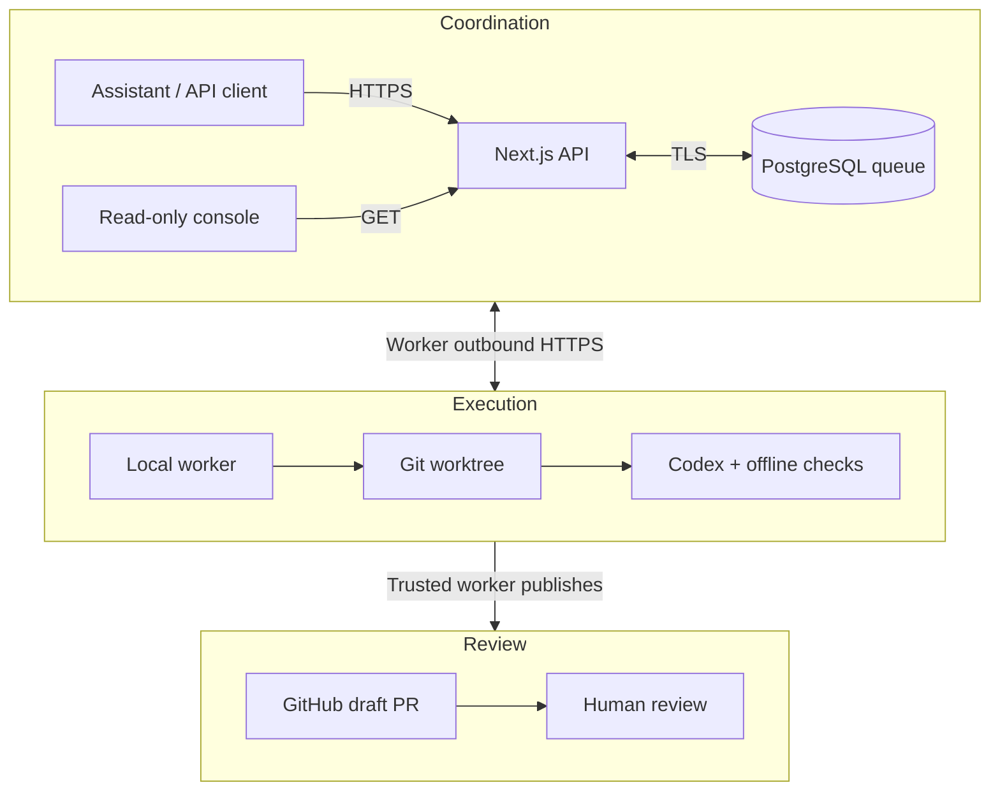

# Conduit

[](https://conduit-poc.vercel.app)    

**From a development request to a reviewable draft pull request.**

Conduit connects an assistant such as Instinct to a local Codex worker through an authenticated job API and a persistent PostgreSQL queue. Submit a task, track its execution, inspect the diff, and request revisions on the same PR.

The API coordinates the work; your local machine executes it. Each development task gets an isolated Git worktree, and verified changes become a **draft PR for human review**.

[Console](#read-only-console) · [Workflow](#how-it-works) · [Get started](#get-started) · [Security](#boundaries-and-security) · [Documentation](docs/README.md)

## Read-only console

Open [`/app`](https://conduit-poc.vercel.app/app) to connect; it redirects to `/app/board`. The console provides three views:

| View                             | What it shows                                                                                             |
| -------------------------------- | --------------------------------------------------------------------------------------------------------- |
| **Job board** · `/app/board`     | Jobs grouped by queued, running, completed and failed / blocked status, with title, ID and status search. |
| **Active** · `/app/active`       | Reported workers, freshness, assigned jobs, leases, execution attempts, checks and publication state.     |
| **Needs you** · `/app/needs-you` | Review and recovery signals derived from reported jobs, dependencies and worker availability.             |

Open a job for instructions, results, execution history, verification outcomes, changed files, recorded publication details and recent activity. Raw JSON remains available in a disclosure. GitHub links lead to external review; displayed commands are selectable text. The console cannot submit, revise, retry, approve, merge or clean up jobs.

Connect with a **read-only viewer key** scoped to `jobs:read`. Keys stay in React memory and are forgotten on refresh or disconnect. Console data reads are same-origin GET requests with bearer authentication. Email/password sign-in and sign-up appear when Supabase Auth is configured; an administrator must link the account to a workspace principal before it can read that principal's jobs. Email sessions persist in localStorage across refreshes. Authentication requests go directly to Supabase Auth, separately from the same-origin console reads.

The console polls about every three seconds while visible and retains the last successful snapshot with a warning when reads fail. Counts and attention signals cover the latest 100 loaded jobs. Job sheets load evidence on opening; recent activity refreshes every five seconds while visible. Publication details are recorded observations, not a live guarantee of GitHub state.

See [console access, storage and data limits](docs/gui.md) for setup and shortcuts.

## What it can do

- **Prepare through a current PM protocol.** External assistants retrieve the authenticated agent manifest, choose normal or researched detailed mode, and retain cited preparation context. See the [Phase 5A protocol and rollout](docs/phase-5a-agent-protocol.md) and [short Instinct standing instruction](docs/instinct-standing-instruction.md).
- **Coordinate persistent initiatives.** Save versioned task plans, activate them atomically, track merge-gated dependencies and PM assessments, and resume across conversations. See [Phase 5B](docs/phase-5b-initiatives.md).
- **Resume from durable activity.** Read an owner-scoped event feed and save a checkpoint across sessions. See [Phase 5C](docs/phase-5c-events.md).
- **Monitor on an Instinct schedule.** Read owned activity, current attention items, and worker readiness in one snapshot. See [Phase 5D](docs/phase-5d-monitoring.md) and [Instinct setup](docs/instinct-monitor-setup.md).
- **Track durable jobs.** UUID idempotency keys support submission retries with an identical body. Scoped credentials separate submitters from workers.
- **Work in registered repositories.** An administrator approves projects, base branches, workspace permissions and verification commands.
- **Run Codex in isolated worktrees.** Each root task gets a feature branch and retained workspace. The local worker executes up to `CONDUIT_MAX_AGENTS` jobs concurrently (default `4`), with one job per agent in a network-disabled sandbox.
- **Publish for review.** Configured checks gate publication. Retrieve execution history, changed-file metadata, bounded diffs and draft PR details through the API.
- **Revise the same PR.** A revision is a new tracked job on the original branch and PR. Worktrees and recovery journals survive outcomes.

`CONDUIT_MAX_AGENTS` accepts integers `1`–`4`; invalid values stop startup with an error. The server also enforces a cap of 4 running jobs with live leases per owner (`submitter_id`), across all worker processes and identities. This bounds leased jobs; each worker's agent limit controls its physical execution concurrency. Expired leases do not consume a slot, and their local processes remain subject to existing lease fencing and recovery. Dependency jobs wait until every prerequisite's pull request is merged; completion without a merge is not done.

The implementation also supports success/failure simulation jobs for connectivity checks and `codex_task` jobs in a fixed TypeScript sandbox. These simulations are queue probes; there is no simulator UI or device simulator integration.

## How it works



The worker claims and reports jobs through outbound API requests; it needs no inbound tunnel or direct database connection. Codex and verification run in the sandbox; the trusted worker handles GitHub authentication, commits and publication outside it.

1. **Submit.** Send a `development` job for an approved project with instructions, acceptance criteria and a stable UUID `Idempotency-Key`.
2. **Execute.** The worker claims a leased job, prepares its worktree, runs Codex and executes administrator-configured checks.
3. **Inspect.** Retrieve `/api/jobs/:id/changes`, `/diff` and `/publication`. Diff responses are bounded and paginated.
4. **Revise.** Submit to `/api/jobs/:id/revisions` with a new idempotency key. The worker verifies and updates the same branch and draft PR.

For development jobs, `completed` means verified code was published to a branch with an open draft PR. Review and merge remain human decisions. Conduit does not merge or deploy; **existing connected hosting may independently auto-deploy `main` after a merge**.

## Get started

Use **Node.js 24.x** and npm. Real Codex execution also requires the supported macOS sandbox, a local Codex login and prepared dependencies. Running the API alone does not provide a worker.

### 1. Verify a checkout

In a trusted local development environment, outside the offline worker sandbox:

```sh
npm ci
npm test
npm run build
npm run typecheck
```

The full suite starts disposable loopback PostgreSQL clusters, a real HTTP API and worker processes; do not run it as root. No Docker is required. Real Codex and live GitHub checks need separate opt-in setup in the runbooks.

**Worker verification is narrower.** The documented repository profile runs Next route-type generation, TypeScript checking and offline unit tests. It excludes database/network checks and certain subprocess harnesses. Passing that profile does not establish that the full suite passes. Run the complete suite separately before merging. See [verification scopes and historical evidence](docs/README.md#verification-and-history).

### 2. Choose an API and queue

- **Local development:** follow the [local setup guide](docs/operator-guide.md#local-setup-and-full-verification) for `npm run db:local`, restricted runtime provisioning, private configuration and `npm run dev`. Preserve existing configuration before bootstrap commands write local files.
- **Hosted installation:** follow the [Vercel + Supabase runbook](docs/deployment.md). Schema migration, runtime credentials and key administration are separate operator responsibilities.

### 3. Connect the console

| Credential                   | Access                                                                   | Browser storage                          |
| ---------------------------- | ------------------------------------------------------------------------ | ---------------------------------------- |
| `cnd_live_` API key          | Existing assigned principal and scopes                                   | GUI viewer key: React memory only        |
| Supabase Auth email/password | Exactly `jobs:read`, only after explicit admin UUID-to-principal mapping | Session in localStorage across refreshes |

See [console authentication and storage risks](docs/gui.md) and [account administration](docs/operator-guide.md#supabase-auth-account-links). Supabase Auth does not change worker authentication or `/auth-check`.

For GUI access, use `npm run key -- create --type viewer --principal ID --name NAME` with the job owner's principal. This key has only `jobs:read` and cannot create, revise, claim, or update jobs. Paste it into Connect; the GUI holds it in React memory only.

### 4. Connect a worker

Issue separate submitter and worker keys through the [local key-management CLI](docs/operator-guide.md#persistent-api-keys), then start the worker against your API:

```sh
CONDUIT_API_URL=https://YOUR-PROJECT.vercel.app \
WORKER_KEY_FILE=.secrets/worker.json \
WORKER_STATE_DIR=.worker/your-worker \
npm run worker
```

Use `http://127.0.0.1:3000` for loopback development. Keep the state directory across restarts and use a separate one for each queue/worker identity. Credentials stay in private local files.

Prove the queue/worker loop with the [smoke and recovery checks](docs/manual-test.md). To execute repository tasks, complete [project registration, GitHub policy, Codex setup and verification configuration](docs/PHASE_4_TESTING.md) first; a queue-only installation cannot publish development PRs.

## API at a glance

All `/api/*` routes require scoped bearer authentication. The [API and queue guide](docs/operator-guide.md#api-contract) covers payloads, errors and lease behavior; the [development runbook](docs/PHASE_4_TESTING.md) adds projects, revisions, artifacts and publication.

| Route                          | Purpose                            |
| ------------------------------ | ---------------------------------- |
| `POST /api/jobs`               | Submit an idempotent job           |
| `GET /api/jobs/:id`            | Read status, phase and result      |
| `GET /api/projects`            | Discover approved projects         |
| `GET /api/jobs/:id/diff`       | Review actual changes              |
| `POST /api/jobs/:id/revisions` | Request a same-PR revision         |
| `GET /api/workers`             | Observe recent worker availability |

`/info` is a **static code-derived descriptor**, available as JSON or HTML; it proves no live readiness. `/health` checks API/database access, `/auth-check` validates credential access, and `/api/workers` reports recent heartbeats. A completed probe establishes the end-to-end loop; a heartbeat alone is no execution guarantee.

## Boundaries and security

Conduit is an engineering prototype with explicit operator responsibilities:

- **At-least-once execution.** Lease fencing rejects stale reports and journals support recovery, but idempotent submission does not make execution exactly once. Interrupted edits, conflicts and stale locks can require manual recovery.
- **Local trust boundary.** The administrator controls registration, workspace permissions, credentials and verification. Jobs cannot widen that policy. Sandbox isolation and heuristic secret detection do not constitute a security audit.
- **Credential limits.** `strict_bot` is the default GitHub policy and audits required repository restrictions. Explicit `prototype` mode can use an existing GitHub login or PAT with merge/admin capabilities. See [policy and credential requirements](docs/PHASE_4_TESTING.md#github-security-policies-and-credentials).
- **Private configuration.** Submitter/worker keys are scoped and revocable; the database stores their hashes. Runtime, key-management and schema-administrator access are separate. Keep environment files, keys, journals and private project configuration out of commits and shared logs.
- **Human control.** No automatic merge, draft-to-ready transition, deployment or destructive worktree cleanup. Review repository protections and connected deployment triggers before merging.

The read-only web console supports API keys and Supabase Auth email/password accounts with explicit administrator workspace mappings. Hosted readiness, external Instinct acceptance and live Codex/GitHub verification must be established for each installation; historical results are not current guarantees.

## Repository map

| Path                                                          | Contents                                          |
| ------------------------------------------------------------- | ------------------------------------------------- |
| [src/app/](src/app/)                                          | Next.js HTTP routes                               |
| [src/lib/](src/lib/)                                          | Authentication, queue, development API and checks |
| [worker/](worker/)                                            | Outbound worker, Codex execution and publication  |
| [scripts/](scripts/)                                          | Local administration and smoke probes             |
| [supabase/migrations/](supabase/migrations/)                  | Versioned schema and permissions                  |
| [tests/](tests/) · [sandbox/typescript/](sandbox/typescript/) | Test suites and fixed Codex fixture               |
| [docs/](docs/README.md)                                       | Setup, integration, recovery and evidence index   |

Start with the [documentation index](docs/README.md) for the operator guides, API contracts and retained implementation history.

## License

MIT. See [LICENSE](LICENSE).
